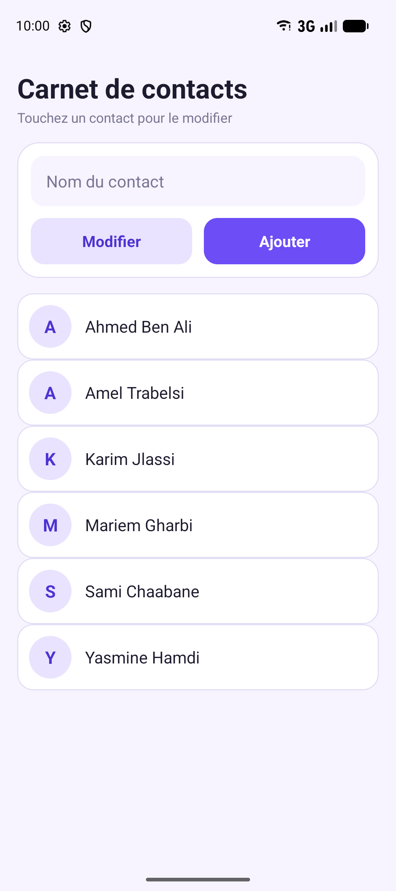
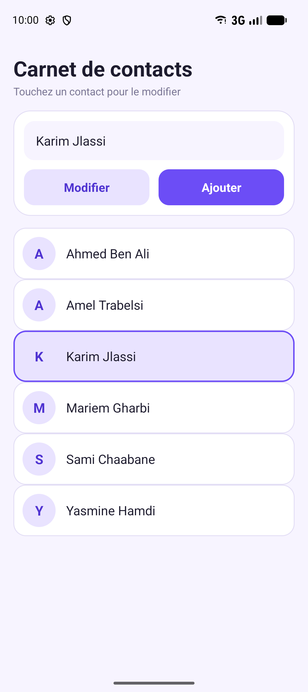
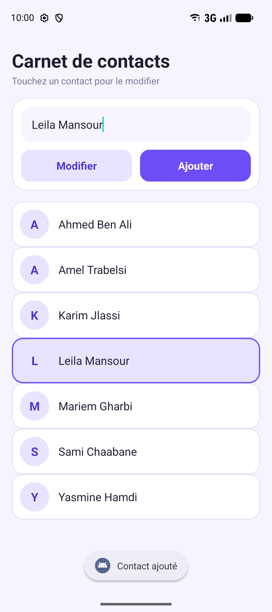
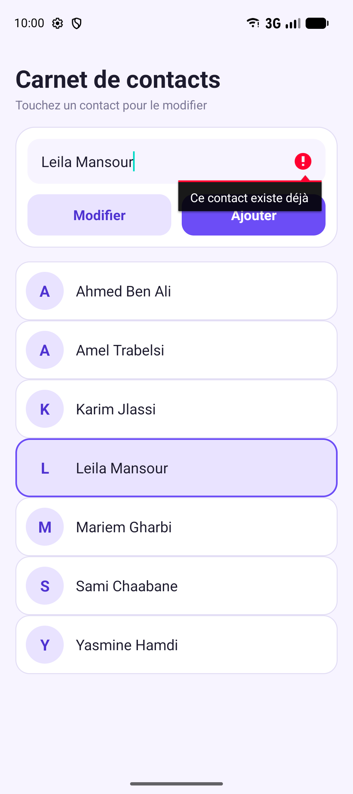
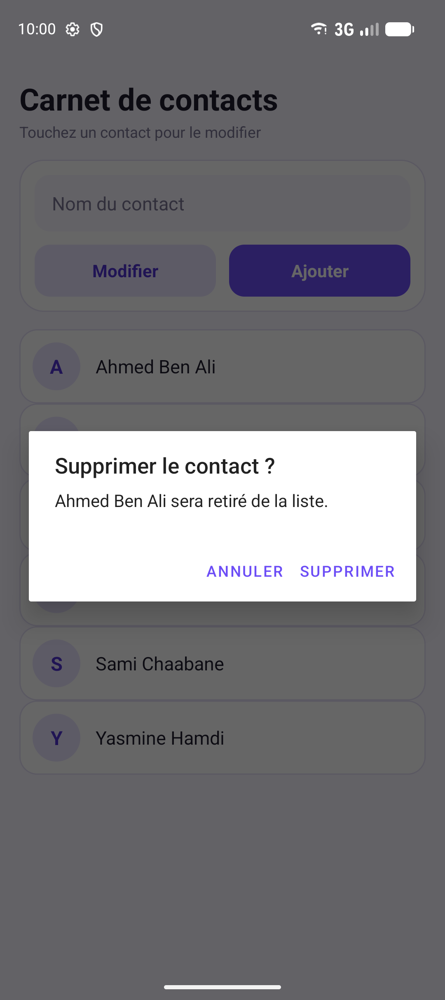
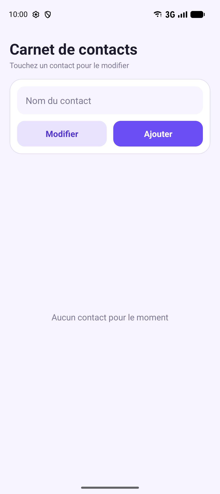

# Carnet de contacts — ContactsListView (Android · Kotlin & XML)

Redesigned version of the ContactsListView lab: same features, new **violet & cream card** look with initials avatars.

## Screenshots

| Contact list | Selected contact | Contact added |
|:---:|:---:|:---:|
|  |  |  |

| Duplicate refused | Delete confirmation | Empty state |
|:---:|:---:|:---:|
|  |  |  |

## Features

- Contacts displayed through an `ArrayAdapter` bound to a `ListView`
- Tap a contact → it is highlighted (activated state) and copied into the input field
- Edit the selected contact with validation (non-empty name, active selection required)
- Instant UI refresh with `notifyDataSetChanged()`
- Validate with the **Done** key of the soft keyboard (`IME_ACTION_DONE`)

### Bonus ("Pour aller plus loin")

1. **Add button** — dynamically add new contacts
2. **Long-press to delete** — `AlertDialog` confirmation
3. **Uniqueness check** — duplicates refused (case-insensitive)
4. **Alphabetical sorting** — after every edit or addition
5. **Rotation survival** — state saved/restored in `onSaveInstanceState`

### New in this version

- Initial-letter avatar for each contact
- Empty-state message when the list has no contacts
- Rounded cards, violet accent for the selected row

## Run

1. Open the folder in **Android Studio** (Gradle 8.7 is fetched from `gradle-wrapper.properties`).
2. Sync Gradle and run on an emulator or device.
# ContactsListView
